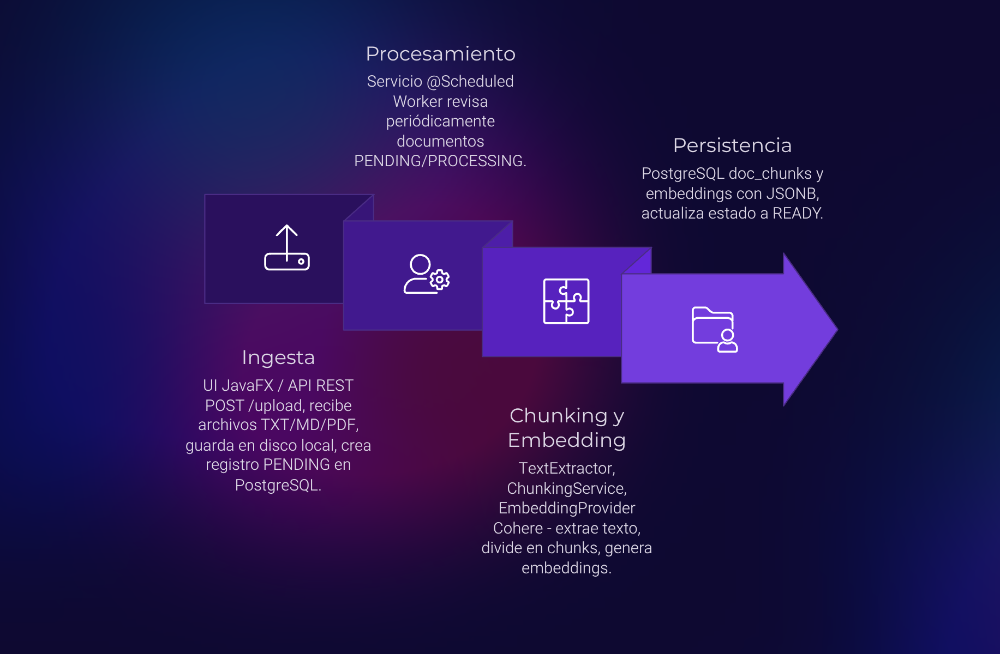
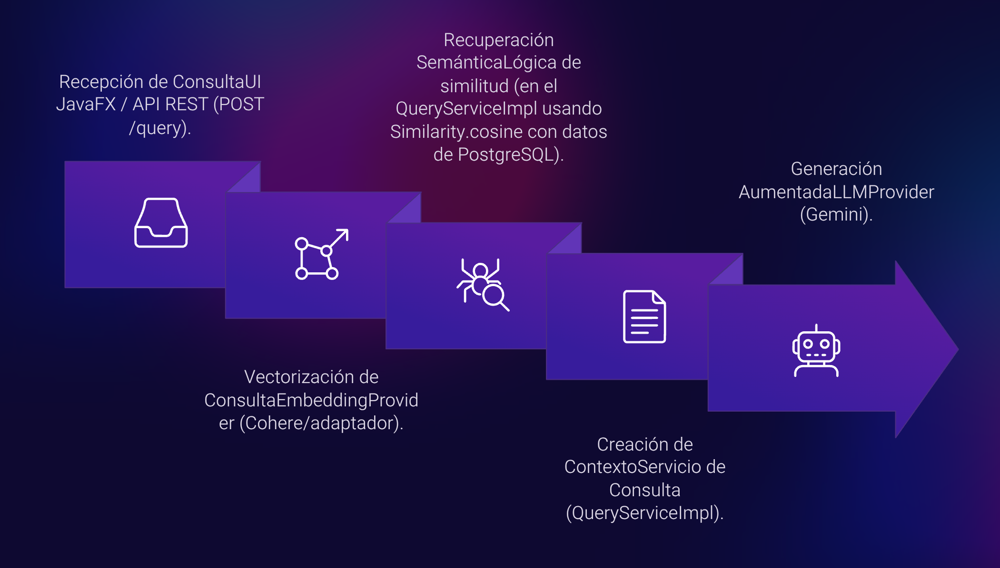
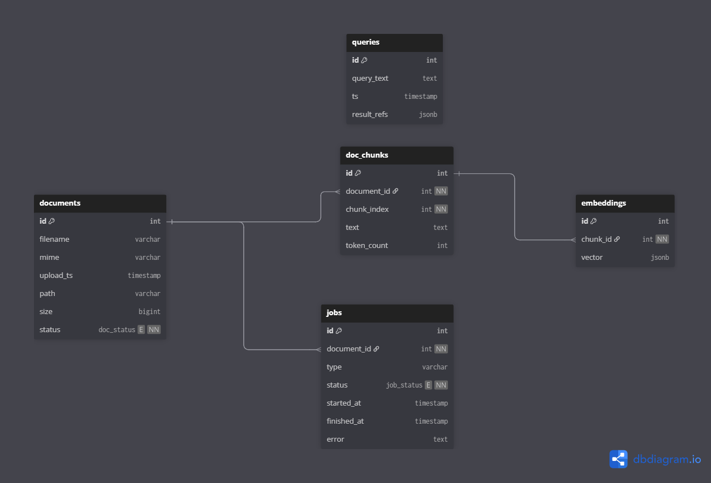
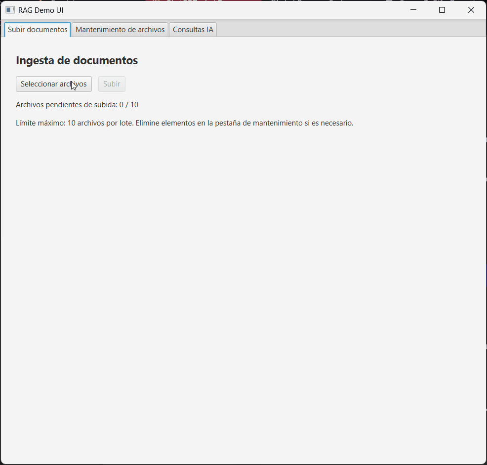

# Documento Ejecutivo

## 1. Información General
La solución implementa una plataforma de *Retrieval-Augmented Generation* (RAG) para cargar hasta diez documentos en formatos TXT, Markdown o PDF, procesarlos asincrónicamente y responder preguntas sobre su contenido mediante un modelo de lenguaje grande (LLM). El objetivo es ofrecer una herramienta de consulta confiable que combine la precisión de la búsqueda semántica con la generación natural del LLM, manteniendo altos niveles de control y auditoría sobre los datos.

## 2. Arquitectura General
La arquitectura se estructura en cuatro capas principales:

1. **Ingesta y almacenamiento de documentos.** Una API REST en Spring Boot recibe los archivos y los almacena junto con su metadato básico en PostgreSQL.
2. **Procesamiento asincrónico.** Un servicio programado revisa periódicamente los documentos pendientes y ejecuta el pipeline de chunking, embeddings y persistencia de vectores.
3. **Recuperación semántica.** Al recibir una pregunta, el motor de búsqueda calcula la similitud coseno entre la consulta embebida y los vectores almacenados para recuperar los fragmentos más relevantes.
4. **Generación aumentada.** El LLM (Gemini por defecto) recibe los fragmentos seleccionados como contexto y produce una respuesta natural junto a referencias de soporte.

Estas capas se comunican mediante servicios Spring y repositorios JPA, encapsulando la lógica y permitiendo intercambiar proveedores externos (por ejemplo, Cohere para embeddings) sin afectar el resto del sistema. La arquitectura se despliega en contenedores Docker para la aplicación y la base de datos, facilitando la operación en entornos controlados.

## 3. Decisiones Clave de Diseño

### Uso de PostgreSQL y `pgvector`
* Se eligió PostgreSQL 15 por su estabilidad y soporte empresarial. Para entornos con la extensión **pgvector**, los embeddings pueden almacenarse como vectores nativos y aprovechar índices IVFFlat para búsquedas rápidas.
* En escenarios donde pgvector no está disponible (como entornos restringidos o evaluaciones académicas), se recurre a columnas `JSONB` que guardan los arreglos de `double`. Esto mantiene la compatibilidad con la misma estructura de tablas y permite migrar a pgvector sin refactorizaciones.
* La base de datos está normalizada en tercera forma normal (3FN): `documents` para metadatos, `doc_chunks` para fragmentos, `embeddings` para representaciones vectoriales y tablas de auditoría (`queries`, `jobs`). Esta separación reduce redundancia, permite múltiples modelos de embeddings y conserva trazabilidad.

### Integración con LLMs y proveedores externos
* Se definieron interfaces `EmbeddingProvider` y `LLMProvider` para desacoplar la aplicación de proveedores específicos. Actualmente se utilizan Cohere (embeddings) y Gemini (generación), pero la arquitectura admite cambiar a alternativas compatibles.
* La comunicación con servicios externos se realiza mediante OkHttp, centralizando tiempos de espera y manejo de errores para aislar fallas temporales.

### Experiencia de Usuario y Observabilidad
* La API expone endpoints REST (`/api/upload`, `/api/query`, `/api/documents`) complementados con una interfaz JavaFX ligera para usuarios finales.
* Se registran los estados de procesamiento en una tabla `jobs`, permitiendo monitoreo de la ingesta y diagnósticos cuando el pipeline detecta errores o documentos inválidos.

## 4. Flujos Operativos con Diagramas

### 4.1 Flujo 1 – Ingesta y Procesamiento Asíncrono (Pipeline Offline)



El primer diagrama resume el recorrido completo de un archivo desde que es cargado hasta que queda disponible para las consultas. El flujo está diseñado para ser no bloqueante y se divide en cuatro capas claramente desacopladas:

1. **Ingesta (UI JavaFX / API REST).** El usuario selecciona uno o varios archivos desde la interfaz JavaFX; el `UploadController` expone `POST /api/upload` para recibir la petición multipart. El `StorageServiceImpl` guarda el archivo físicamente y el `DocumentService` crea el registro en la tabla `documents` con estado `PENDING`, tamaño, ruta y metadatos capturados.
2. **Procesamiento asíncrono (Servicio @Scheduled).** `IngestionServiceImpl.processPending()` se ejecuta cada 10 segundos gracias a `@Scheduled`. Por cada documento pendiente se abre un registro en `jobs`, se marca el documento como `PROCESSING` y se gestionan las excepciones para dejar evidencia en `JobLogRepository` en caso de fallas.
3. **Chunking y embeddings (TextExtractor + ChunkingService + EmbeddingProvider).** El `TextExtractorImpl` utiliza PDFBox para convertir PDFs a texto y lee directamente TXT/MD. Luego `ChunkingServiceImpl` agrupa el contenido en fragmentos de hasta ~1.000 caracteres con 200 de *overlap* para preservar el contexto. Cada fragmento se vectoriza mediante `CohereEmbeddingProvider`, que envía el texto a la API de Cohere y devuelve un arreglo `double[]` con la representación semántica.
4. **Persistencia en PostgreSQL.** Los fragmentos se guardan con `DocChunkRepository` en `doc_chunks` y sus embeddings en `embeddings`, usando columnas `JSONB` compatibles con pgvector. Tras terminar el procesamiento se marca el documento como `READY` y el job pasa a `DONE`. Cualquier error deja el documento en `ERROR`, conserva la traza en `jobs` y permite reprocesos manuales.

Gracias a esta orquestación, la subida inicial responde inmediatamente con los IDs generados, mientras que el trabajo pesado (lectura de PDFs, chunking y llamadas a Cohere) ocurre en segundo plano. Esto permite escalar horizontalmente el worker, repartir la carga y ofrecer retroalimentación continua a la UI (las tablas de estado en la base se consultan desde `GET /api/documents`).

### 4.2 Flujo 2 – Consulta y Generación Aumentada (Pipeline Online)



El segundo diagrama muestra el recorrido de una pregunta y cómo se materializa la respuesta aumentada con contexto relevante:

1. **Recepción de la consulta.** Desde la sección *Preguntar* de la UI JavaFX se envía el texto al endpoint `POST /api/query`, expuesto por `QueryController`. Este componente valida los parámetros y delega la lógica en `QueryServiceImpl`.
2. **Vectorización de la pregunta.** `QueryServiceImpl` invoca nuevamente al `EmbeddingProvider` (Cohere) para transformar la pregunta en un vector. Esta reutilización garantiza que pregunta y chunks vivan en el mismo espacio semántico.
3. **Recuperación semántica.** Con el vector calculado, el servicio consulta `DocChunkRepository` y `EmbeddingRepository`, reconstruye los vectores con `EmbeddingServiceImpl.parse()` y calcula la similitud coseno (`Similarity.cosine`). Los `k` fragmentos con mejor puntuación conforman el contexto candidato.
4. **Construcción de contexto y prompt.** Los fragmentos ordenados se serializan con su puntuación y texto, formando un bloque que se concatena con la pregunta original. Esta plantilla obliga al LLM a responder únicamente con la información provista y a citar brevemente las fuentes.
5. **Generación aumentada y auditoría.** El prompt enriquecido viaja al `GeminiLLMProvider`, que interactúa con el modelo Gemini y devuelve una respuesta en lenguaje natural. Antes de responder al cliente, el servicio registra la consulta y las referencias utilizadas en `QueryLogRepository`, preservando trazabilidad y facilitando auditorías.
6. **Entrega al usuario.** La API retorna un `QueryResponseDto` con la respuesta y los `QueryReferenceDto` asociados (documento, chunk y puntaje). La UI JavaFX los presenta en pantalla para que el usuario pueda navegar rápidamente al fragmento de soporte.

Ambos flujos se complementan: el pipeline offline mantiene la base de conocimientos fresca y normalizada, mientras que el pipeline online aprovecha esos datos para ofrecer respuestas precisas en tiempo real.

## 5. Modelo de Datos y Diagrama ER
El modelo relacional se compone de tablas normalizadas hasta 3FN (`documents`, `doc_chunks`, `embeddings`, `jobs`, `queries`) que garantizan integridad referencial y trazabilidad del pipeline completo de RAG.



La imagen anterior resume las claves primarias/foráneas, así como los atributos relevantes para cada etapa (ingesta, chunking, embeddings y consultas).

# Guía de Uso

## 1. Requisitos Previos
Para levantar el entorno completo se recomienda contar con:

* **Docker y Docker Compose** (v2+) para orquestar PostgreSQL y la aplicación Spring Boot.
* **Java 21** y **Maven 3.9+** si se desea ejecutar el backend o la UI JavaFX de manera local sin contenedores.
* **Acceso a llaves de API** para el proveedor de embeddings (Cohere) y del LLM (Gemini, por defecto). El archivo `.env.example` detalla las variables necesarias.

## 2. Configuración del Entorno

1. Clonar el repositorio y posicionarse en la raíz del proyecto.
2. Copiar la configuración base y ajustar credenciales/API keys:
   ```bash
   cp .env.example .env
   # Editar .env para agregar GEMINI_API_KEY y COHERE_API_KEY
   ```
3. (Opcional) Crear la carpeta local para almacenar los archivos subidos si se ejecutará fuera de Docker:
   ```bash
   mkdir -p uploads
   ```

## 3. Puesta en Marcha del Backend

### Docker Compose

1. Construir y levantar los servicios (PostgreSQL + API):
   ```bash
   docker compose up --build
   ```
2. La aplicación quedará disponible en `http://localhost:8080`. Flyway ejecutará automáticamente las migraciones definidas en `src/main/resources/db/migration`.
3. Para detener los servicios:
   ```bash
   docker compose down
   ```


## 4. Monitoreo del Proceso Asíncrono
* Cada archivo cargado se registra como `PENDING` en `documents` y genera un `job` de tipo `INGEST`.
* El servicio programado consulta cada 10 segundos los documentos pendientes, extrae texto, genera chunks y embeddings, y finalmente marca el documento como `READY` o `ERROR`.
* Los registros pueden consultarse vía API (`GET /api/documents`) o directamente en las tablas `documents` y `jobs`.

## 5. Endpoints Disponibles

| Método | Ruta                   | Descripción                                                                 |
|--------|------------------------|-----------------------------------------------------------------------------|
| POST   | `/api/upload`          | Recibe hasta 10 archivos (`.txt`, `.md`, `.pdf`) y devuelve los IDs creados |
| GET    | `/api/documents`       | Lista todos los documentos con su estado y metadatos básicos                |
| GET    | `/api/documents/{id}`  | Obtiene los detalles y chunks asociados a un documento específico           |
| POST   | `/api/query`           | Ejecuta una pregunta `q` con `k` fragmentos de contexto y devuelve la respuesta del LLM |

## 6. Interfaz JavaFX

La UI de escritorio ofrece una vista unificada para cargar archivos, revisar el estado de ingesta y formular preguntas.



1. Asegúrese de que el backend esté disponible (Docker Compose o ejecución local).
2. Desde la raíz del proyecto ejecute:
   ```bash
   mvn -DskipTests javafx:run
   ```
3. Por defecto la UI se conecta a `http://localhost:8080/api`. Para apuntar a otra URL utilice la variable de entorno `RAG_API_BASE_URL` o el sistema de propiedades de Java:
   ```bash
   RAG_API_BASE_URL="http://192.168.1.50:8080/api" ./mvnw javafx:run
   # o
   ./mvnw javafx:run -Drag.api.base-url=http://localhost:8081/api
   ```
4. La ventana muestra tres secciones principales: selección y subida de archivos, tabla de estado y cuadro de preguntas con referencias.

## 7. Flujo End-to-End Recomendado

1. Levantar PostgreSQL y la API (sección 3).
2. Acceder a `http://localhost:8080/api/documents` para verificar la conectividad inicial.
3. Subir archivos mediante la UI JavaFX o usando `curl`.
4. Esperar a que el estado cambie a `READY` (consulta periódica desde la UI o el endpoint `/api/documents`).
5. Enviar preguntas desde la UI o vía API y revisar las referencias devueltas.

## 8. Recursos y Documentación Complementaria
* **DDL y scripts:** `docs/scripts/init_schema.sql` contiene la creación explícita de tablas e índices.
* **Migraciones Flyway:** ubicadas en `src/main/resources/db/migration` para inicializar el esquema automáticamente.
* **Diagrama ER en alta resolución:** `docs/diagramaER.png`.
