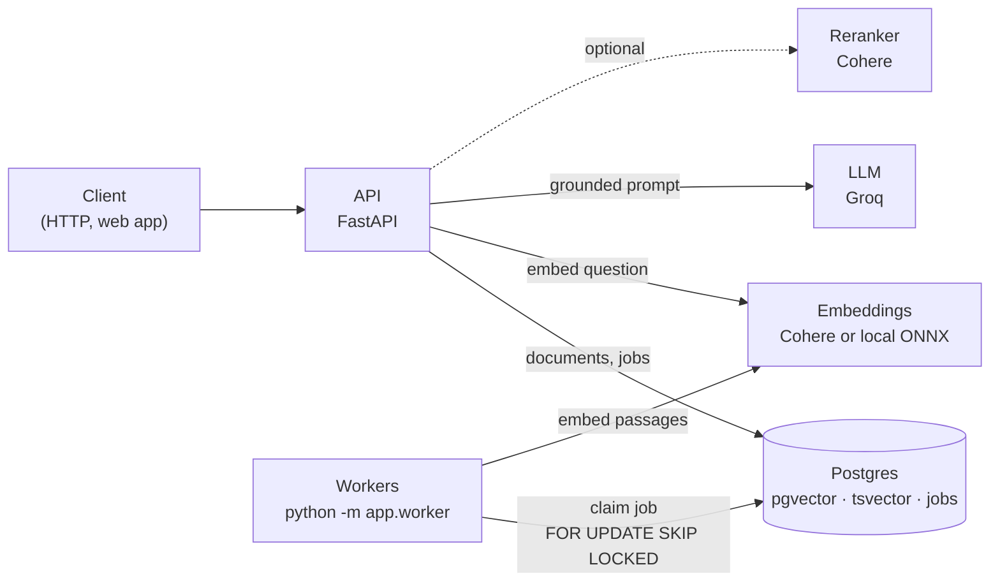

# Architecture

Three processes share one Postgres database: the API answers questions, workers turn uploaded
files into embedded chunks, and Postgres stores everything, including the vectors and the job
queue. There is no separate vector database and no message broker.

## Code map

| Path | Responsibility |
| :-- | :-- |
| `app/routers/` | HTTP layer: validation, response models. No business logic. |
| `app/core/` | Settings (`config.py`) and the error contract (`errors.py`). |
| `app/ingestion/storage.py` | Safe upload storage: server-generated names, streaming size limit, content checks. |
| `app/ingestion/queue.py` | The job queue on the `jobs` table: enqueue, claim with a lease, retry with backoff. |
| `app/ingestion/pipeline.py` | Extract → chunk → embed → replace the document's chunks (idempotent). |
| `app/worker.py` | Worker loop: claims and processes jobs until stopped. |
| `app/retrieval/dense.py` | Cosine search through the HNSW index. |
| `app/retrieval/lexical.py` | Full-text search on the generated `tsvector` column. |
| `app/retrieval/fusion.py` | Reciprocal Rank Fusion. |
| `app/retrieval/retriever.py` | Runs dense, lexical or hybrid, then the optional reranker. |
| `app/answering/service.py` | The abstention gate, passage selection, the model call, the query log. |
| `app/answering/citations.py` | Checks `[n]` markers against the passages that were sent. |
| `app/providers/` | Embeddings, LLM and reranker clients behind small protocols, with retries. |
| `migrations/` | Alembic migrations, from the v1 schema to the current one. |
| `eval/` | Benchmark corpus, questions and runner. |
| `bench/` | Vector search latency benchmark. |
| `web/` | Angular client: ask with citations, library, benchmarks. |

## A question, step by step

1. `POST /api/query` validates the body (`QueryRequest`).
2. `retrieve()` embeds the question (`embed_query`, `search_query` input type) and runs the
   dense and lexical searches, each returning `4 × k` candidates, fused with RRF.
3. **Gate:** if the best cosine similarity is below `MIN_SIMILARITY`, the answer is
   `insufficient_evidence` and nothing else happens.
4. `select_passages()` keeps the best candidates that fit the token budget and numbers them.
5. The model answers from the numbered passages at temperature 0, or says `NO_ANSWER`.
6. `check_citations()` keeps valid `[n]`, removes invented ones and reports them.
7. The outcome is logged in `queries` and returned with every passage and its scores.

## A document, step by step

1. `POST /api/upload` streams each file to `<uuid><ext>`, checks its content, and creates the
   `documents` row and its `jobs` row in one transaction.
2. A worker claims the job (`attempts + 1`, lease until `now + JOB_LEASE_SECONDS`).
3. The pipeline extracts the text, chunks it, embeds every chunk (`search_document`) and
   replaces the document's chunks. Postgres fills `tsv` itself.
4. Success marks the job `DONE` and the document `READY`. A failure schedules a retry with
   backoff, or marks both as `ERROR` after the last attempt. A worker that dies leaves an
   expired lease, and another worker picks the job up.

## Database

| Table | Notes |
| :-- | :-- |
| `documents` | One row per uploaded file. `embedding_model` records which model produced its vectors. |
| `doc_chunks` | `text`, `embedding vector(N)` with an HNSW index, `tsv tsvector` (generated) with a GIN index. |
| `jobs` | The ingestion queue: `status`, `attempts`, `run_after`, `locked_by`, `locked_until`. |
| `queries` | Every question with its outcome, best similarity, passages and citations. |

`N` is the dimension of the configured embedding model (1024 for Cohere v3, 384 for the local
model). Changing the model means a new migration of that column and re-ingesting every
document (`POST /api/documents/{id}/reingest`).
